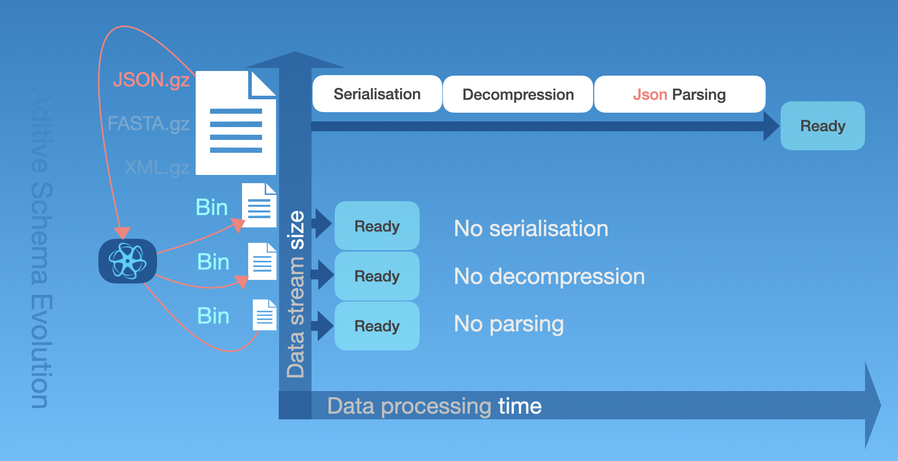

# SAS Quantome | Upstream Bio-Data Architecture 💎

Quantome is an independent systems engineering practice established in 2013 in Paris, France. We eliminate upstream data bottlenecks in AI, machine learning, and high-throughput computational biology pipelines. 

We govern data soundly by keeping digital assets free from infrastructure bloat, archaic file overhead, and vendor lock-in. Our open-source engines deterministically transform raw, heterogeneous biological substrates into immutable, vertically partitioned binary arrays engineered for zero-copy memory-mapped (`mmap`) model ingestion.

### Open-Source Architecture Stack

* **[`interlace-go`](https://github.com/sas-quantome/interlace-go)** — Columnar binary shredding engine written in Go for zero-copy PyTorch/NumPy [ingestion](https://github.com/sas-quantome/interlace-go/blob/main/pkg/README.md#12-binary-file-integrity-check).
* **[`interlace-do`](https://github.com/sas-quantome/interlace-do)** — Deterministic DAG orchestrator ([`a32005`](https://github.com/sas-quantome/interlace-do/tree/main/cmd/a32005/README.md)) and provenance journaling framework.
* **[`interlace-ex`](https://github.com/sas-quantome/interlace-ex)** — Reference multi-omic pipelines and 40x consolidation benchmarks (57 GB → 1.4 GB).

*Quant ★ ome ᯓ➤ quantitative analysis 🧪 of biological molecules 🧬 or entities 🦠 in an organism 👣*

---

**Web:** [sas-quantome.com](https://www.sas-quantome.com) · **Contact:** [connections@sas-quantome.com](mailto:connections@sas-quantome.com)

###### November 10, 2026: main readme v87
